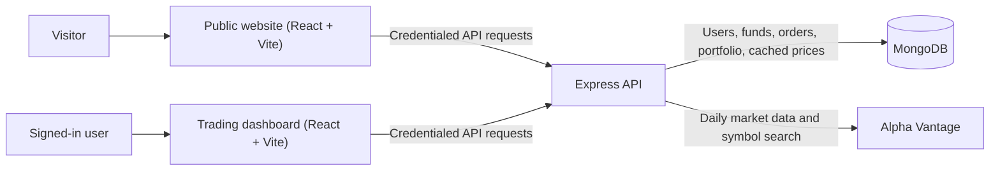

# EquityFlow

EquityFlow is a full-stack paper-trading application. Users can create an
account, receive virtual cash, explore supported market symbols, place
simulated buy and sell orders, and review their funds, holdings, positions, and
order history. It is for practice and portfolio tracking; it does not connect
to a brokerage or move real money.

The project is split into a public website, a trading dashboard, and a backend
API. Each web application is built and run independently.

**Live Demo:** [EquityFlow](https://equity-floww.vercel.app/)

## Quick start

- [ ] Install Node.js `^20.19.0` or `>=22.12.0`, npm, and a
  replica-set-capable MongoDB database. An Alpha Vantage key is needed for
  uncached market data.
- [ ] Clone the repository and run `npm ci` in `backend/`, `frontend/`, and
  `dashboard/` ([commands](#clone-and-install)).
- [ ] Copy the three `.env.example` files to the local filenames and configure
  the backend origins, MongoDB URL, and private JWT secret
  ([environment variables](#environment-variables)).
- [ ] Seed default tradable symbols with `npm run seed:stocks` from `backend/`.
- [ ] Start the backend, public website, and dashboard in separate terminals
  ([local run commands](#run-locally)).

## Key features

- Account registration, login, session checks, and logout using JWTs in an
  HttpOnly session cookie.
- User-specific virtual funds, orders, holdings, positions, and watchlist
  preferences.
- Paper orders that debit or credit virtual cash and update holdings and
  positions transactionally.
- A configurable starting balance of `100000` virtual currency units for new
  accounts. Accounts start with no holdings or positions; trades create them.
- A watchlist with a seeded set of tradable symbols and support for adding
  provider-mapped symbols.
- Daily market quotes, history, and symbol search through Alpha Vantage, with
  MongoDB-backed daily-price caching, stale-data indicators, and persisted
  provider-quota handling.
- Portfolio summaries that mark values as partial when prices are unavailable.

## Tech stack

| Area | Technologies |
| --- | --- |
| Public website | React 19, Vite 7, Tailwind CSS 4, React Router |
| Trading dashboard | React 19, Vite 7, Tailwind CSS 4, Material UI, Axios, React Router |
| Backend API | Node.js, Express 5 |
| Database | MongoDB with Mongoose |
| Authentication | JSON Web Tokens, HttpOnly cookies, bcryptjs password hashing |
| Market data | Alpha Vantage |
| Deployment arrangement | Vercel for the two web apps; Render for the backend API |

## Architecture

The public website and dashboard are separate browser applications. Both make
credentialed requests to the backend API. The API verifies the session cookie,
scopes user-owned records to the authenticated user, reads and writes MongoDB,
and fetches or serves cached market data.



In the documented deployment arrangement, the two web apps are deployed as
separate Vercel projects and the API as a Render web service. The API's CORS
allowlist is configured with the exact public origins of both web apps.

## Project structure

```text
.
├── backend/
│   ├── data/                 # Default stock symbols
│   ├── middleware/           # Authentication middleware
│   ├── model/                # Mongoose models
│   ├── routes/               # API route modules and route tests
│   ├── schemas/              # MongoDB schemas
│   ├── scripts/              # Stock seeding and demo-data cleanup
│   ├── services/             # Market data and portfolio services
│   ├── .env.example
│   ├── config.js
│   ├── index.js              # Express API and application startup
│   ├── package.json
│   └── README.md
├── dashboard/
│   ├── public/
│   │   └── tradehub-favicon.svg
│   ├── src/
│   │   └── components/       # Trading dashboard views
│   ├── .env.example
│   ├── index.html
│   ├── package.json
│   ├── README.md
│   └── vercel.json
├── frontend/
│   ├── public/               # Website artwork and static assets
│   │   └── equityflow-favicon.svg
│   ├── src/
│   │   ├── landing_page/     # Public website pages
│   │   └── tests/
│   ├── .env.example
│   ├── index.html
│   ├── package.json
│   ├── README.md
│   └── vercel.json
└── README.md
```

Each application also has its own `.env.example`, package lockfile, and
folder-level README. Generated dependency and build-output directories are
omitted above.

## Getting started

### Prerequisites

- Node.js `^20.19.0` or `>=22.12.0` and npm.
- MongoDB. Paper orders use MongoDB transactions, so use a replica-set-capable
  local MongoDB setup or a compatible hosted cluster such as MongoDB Atlas.
- An Alpha Vantage API key for market-data requests that are not satisfied by
  cached data. The backend can start without this key, but new provider
  requests will be unavailable.

### Clone and install

```bash
git clone https://github.com/Mu-m-in/EquityFlow.git
cd EquityFlow

cd backend && npm ci
cd ../frontend && npm ci
cd ../dashboard && npm ci
cd ..
```

There is no root-level package manifest; install dependencies in each
application directory.

### Configure the environment

Create local environment files from the examples:

```bash
cp -n backend/.env.example backend/.env
cp -n frontend/.env.example frontend/.env.development
cp -n dashboard/.env.example dashboard/.env.development
```

Edit the files before starting the apps. For a local setup, use the backend
URL `http://localhost:3002`, the website origin
`http://localhost:5173`, and the dashboard origin
`http://localhost:5174`. Configure the backend with those exact website and
dashboard origins. Use a private random JWT secret and a MongoDB connection
string for your own replica-set-capable database. Do not commit the edited
environment files.

### Seed the default tradable symbols

The API does not seed the stock list on startup. Run this once against the
configured database to populate the default symbols used by the watchlist and
paper-order validation:

```bash
cd backend
npm run seed:stocks
```

### Run locally

Start each app in a separate terminal after configuring the environment.

**Backend API**

```bash
cd backend
npm run dev
```

The backend listens on port `3002` by default and exposes `GET /health`.

**Public website**

```bash
cd frontend
npm run dev
```

**Trading dashboard**

```bash
cd dashboard
npm run dev
```

The example Vite development ports are `5173` for the website and `5174` for
the dashboard. The dashboard checks the API session on load and sends users
who are not signed in to the website's login page.

To run the backend test suite, use `npm test` from `backend/`. The web
applications provide `npm run lint` and `npm run build` scripts.

## Environment variables

The `.env.example` files contain placeholders, not deployable credentials.
Replace them with your own values. `VITE_*` variables are embedded in
browser-facing build assets and must never contain secrets.

### Backend (`backend/.env`)

| Variable | Required | Purpose |
| --- | --- | --- |
| `MONGO_URL` | Yes | MongoDB connection string. Use a replica-set-capable database for transactional orders. |
| `JWT_SECRET` | Yes | Signs and verifies session JWTs. Production requires at least 32 characters; use a random private value in every environment. |
| `FRONTEND_URL` | Yes | Exact allowed origin for the public website, including scheme and host but no path. |
| `DASHBOARD_URL` | Yes | Exact allowed origin for the dashboard, including scheme and host but no path. |
| `PORT` | No | API listening port; defaults to `3002`. Render supplies this in deployment. |
| `NODE_ENV` | No | Runtime mode; defaults to `development`. Production requires secure cookie configuration. |
| `JWT_EXPIRES_IN` | No | JWT lifetime; defaults to `1h`. |
| `PAPER_STARTING_CASH` | No | Starting virtual balance for new accounts; defaults to `100000`. |
| `SESSION_COOKIE_MAX_AGE_MS` | No | Session-cookie lifetime in milliseconds; defaults to `3600000` (one hour). |
| `SESSION_COOKIE_SAME_SITE` | No | Cookie SameSite policy: `lax`, `strict`, or `none`. Defaults to `lax` in development; set explicitly in production. |
| `SESSION_COOKIE_SECURE` | No | Set to `true` for HTTPS. Required in production and when SameSite is `none`; defaults to `false`. |
| `ALPHA_VANTAGE_API_KEY` | No | Enables market-data provider requests. Leave unset if you do not have a key; uncached provider data will then be unavailable. |
| `INDIA_MARKET_HOLIDAYS` | No | Optional comma-separated exchange holidays in `YYYY-MM-DD` format, used when determining India market sessions. |

Safe local-development example (replace the database placeholder and secret):

```dotenv
NODE_ENV=development
PORT=3002
MONGO_URL=mongodb+srv://<username>:<url-encoded-password>@<cluster-host>/equityflow?retryWrites=true&w=majority
JWT_SECRET=replace-with-a-private-random-secret-of-at-least-32-characters
JWT_EXPIRES_IN=1h
PAPER_STARTING_CASH=100000
SESSION_COOKIE_MAX_AGE_MS=3600000
SESSION_COOKIE_SAME_SITE=lax
SESSION_COOKIE_SECURE=false
FRONTEND_URL=http://localhost:5173
DASHBOARD_URL=http://localhost:5174
ALPHA_VANTAGE_API_KEY=<your-api-key>
INDIA_MARKET_HOLIDAYS=
```

URL-encode special characters in a MongoDB username or password. For
production, use HTTPS origins and set `SESSION_COOKIE_SECURE=true`; see
[backend deployment notes](backend/README.md) for the documented cookie
configuration.

### Public website (`frontend/.env.development`)

| Variable | Purpose |
| --- | --- |
| `VITE_API_URL` | Backend API origin. Use `http://localhost:3002` locally; production builds require HTTPS. |
| `VITE_DASHBOARD_URL` | Dashboard origin used after authentication. Use `http://localhost:5174` locally; production builds require HTTPS. |
| `VITE_DEV_PORT` | Optional Vite development-server port; the example is `5173`. |

### Trading dashboard (`dashboard/.env.development`)

| Variable | Purpose |
| --- | --- |
| `VITE_API_URL` | Backend API origin. Use `http://localhost:3002` locally; production builds require HTTPS. |
| `VITE_FRONTEND_URL` | Public website origin used for authentication redirects. Use `http://localhost:5173` locally; production builds require HTTPS. |
| `VITE_DEV_PORT` | Optional Vite development-server port; the example is `5174`. |

The public website and dashboard validate that their production API and
companion-app origins are HTTPS origins. Never put `JWT_SECRET`,
`MONGO_URL`, or the Alpha Vantage key in either web app's environment.

## Authentication and security

Registration and login return a JWT in the `equityflow_session` cookie. The
cookie is HttpOnly, so browser JavaScript cannot read it. Both web apps send
credentialed requests to the API; the backend verifies the JWT in
authentication middleware and returns `401` for missing, invalid, or expired
sessions. Logout clears the cookie.

Reads and writes for user-owned data include the authenticated user's ID in
their database filters. Passwords are stored as bcrypt hashes. The API allows
credentialed CORS requests only from the configured website and dashboard
origins. Registration and login share a limit of 10 requests per IP address
per 15-minute window in each backend process.

For production, use HTTPS, a unique strong `JWT_SECRET`, restricted MongoDB
network access, and exact HTTPS origins in `FRONTEND_URL` and
`DASHBOARD_URL`. Cross-site cookies require `SameSite=None; Secure`; browsers
may block third-party cookies in that arrangement. The folder-level deployment
guides recommend testing sign-in and logout in target browsers and using
related custom domains where possible.

## API documentation

All endpoints are served by the backend. Except for `/health`, registration,
login, and logout, routes below require a valid `equityflow_session` cookie.
The web apps send that cookie using credentialed requests.

| Method | Endpoint | Authentication | Purpose |
| --- | --- | --- | --- |
| `GET` | `/health` | No | Reports API/database readiness. |
| `POST` | `/auth/register` | No; rate-limited | Creates an account, initializes virtual funds, and starts a session. |
| `POST` | `/auth/login` | No; rate-limited | Verifies credentials and starts a session. |
| `POST` | `/auth/logout` | No | Clears the session cookie. |
| `GET` | `/auth/me` | Yes | Returns the current user's public account details. |
| `GET` | `/watchlist` | Yes | Lists the user's selected symbols and available quote data. |
| `POST` | `/watchlist` | Yes | Adds a supported symbol to the user's watchlist. |
| `DELETE` | `/watchlist/:symbol` | Yes | Removes a symbol from the user's watchlist. |
| `GET` | `/market/search?keywords=...` | Yes | Searches supported provider symbols. |
| `GET` | `/market/quote/:symbol` | Yes | Returns the latest available daily quote and its freshness metadata. |
| `GET` | `/market/history/:symbol` | Yes | Returns cached or provider-sourced daily price history. |
| `GET` | `/funds` | Yes | Returns the user's virtual cash balance. |
| `GET` | `/portfolio` | Yes | Returns portfolio totals, partial/stale-data indicators, and holdings summary. |
| `POST` | `/orders` | Yes | Places a paper `BUY` or `SELL` order. |
| `GET` | `/orders` | Yes | Lists the user's orders, newest first. |
| `GET` | `/allHoldings` | Yes | Lists the user's holdings with available valuation data. |
| `GET` | `/allPositions` | Yes | Lists the user's open positions with available valuation data. |

`POST /orders` accepts a JSON body with `symbol`, `type` (`BUY` or `SELL`),
and a positive numeric `quantity`. A buy requires sufficient virtual cash; a
sell requires sufficient quantity of that holding. Orders use the API's
available market quote and are written with the corresponding cash and
portfolio changes in a MongoDB transaction.

## Trading and market data

New accounts receive the configured virtual starting balance but no
pre-populated demo holdings or positions. The `seed:stocks` script seeds the
default stock-symbol list; it does not create user accounts or trades. A paper
order updates both a user's holdings and positions, maintains average cost on
buys, and removes a record when its quantity reaches zero.

The market-data integration is based on Alpha Vantage daily series, not an
intraday live feed. The API builds quotes from the latest available daily bar
and its preceding close. The implementation uses India market-session timing
and refreshes daily prices after the 15:30 India market close. A key is needed
for provider calls; supported cached data may still be available without a
successful new provider response.

Daily market data and symbol mappings are persisted in MongoDB. When a refresh
fails, the API can return the latest cached price and marks it stale; when no
usable price exists, the affected market-data request can fail. Portfolio
totals identify unavailable symbols and report partial values rather than
silently treating missing prices as zero. The backend also tracks a maximum
of 25 Alpha Vantage requests per UTC day in MongoDB and records provider
cooldowns after rate-limit responses.

## Deployment

The repository's deployment guides document the following arrangement:

- **Public website:** a Vercel project rooted at `frontend/`.
- **Trading dashboard:** a separate Vercel project rooted at `dashboard/`.
- **Backend API:** a Render web service rooted at `backend/`, started with
  `npm start` and health-checked at `/health`.
- **Database:** MongoDB Atlas or another MongoDB deployment that supports
  transactions.

Production web builds require HTTPS values for their `VITE_*` service and
companion-app origins. Configure the API's `FRONTEND_URL` and
`DASHBOARD_URL` to match the deployed app origins exactly. Render supplies
`PORT`; do not override it in the Render environment. Read the
[frontend deployment guide](frontend/README.md),
[dashboard deployment guide](dashboard/README.md), and
[backend deployment guide](backend/README.md) for platform-specific setup and
cookie guidance.

No working public demo URL is confirmed by the repository, so none is listed
here.

## Known limitations

- Trading is simulated only. There is no brokerage integration, real-money
  trading, payment processing, or bank/UPI transfer flow.
- Quotes and history use daily market data; prices are not an intraday live
  feed and may be stale or unavailable when the provider quota is exhausted
  or a refresh fails.
- The default tradable symbols must be added to the database using
  `npm run seed:stocks`. Although the cleanup utility can remove records
  flagged as demo data, the application does not automatically provision
  demo holdings or positions for new users.
- Paper orders use MongoDB transactions, so a standalone MongoDB server
  without transaction support is not sufficient.
- The repository documents deployment configuration but does not confirm
  that any particular deployment is currently online.
